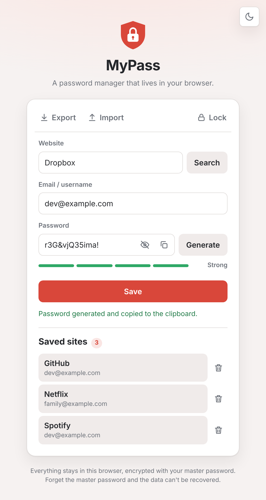
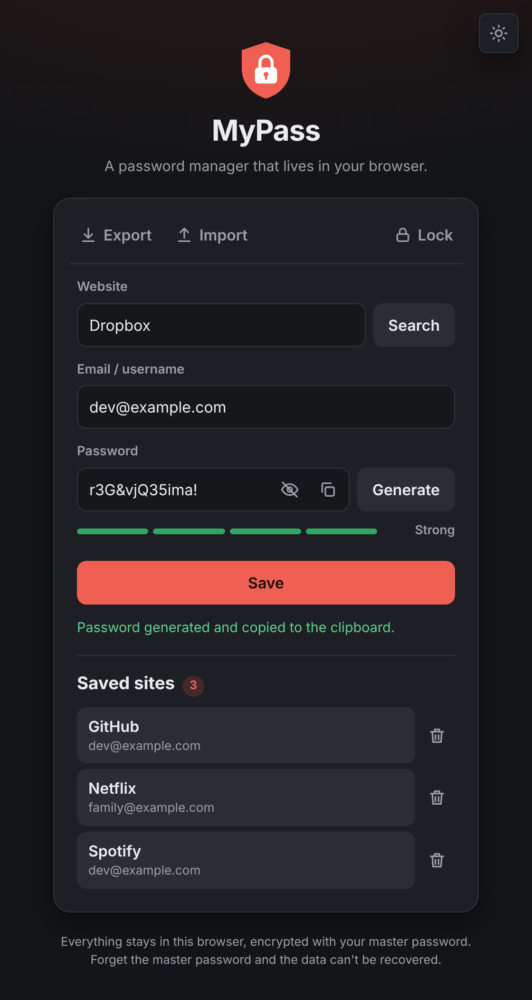

# MyPass


Um gerenciador de senhas que roda **inteiro no navegador**: sem servidor, sem conta, sem enviar nada para lugar nenhum. A lógica é escrita em **Python** (executado no navegador com [Pyodide](https://pyodide.org)) e a criptografia usa a **Web Crypto API**.

> **English summary:** MyPass is a client-side password manager. Python (via Pyodide) handles password generation, strength scoring and data handling; JavaScript draws the page and encrypts the vault with AES-GCM, using a key derived from your master password with PBKDF2. Everything is stored encrypted in your browser's `localStorage`. It's an educational project and hasn't been security-audited. See the sections below (in Portuguese) for details.

<p align="center">
  
  &nbsp;&nbsp;
  
</p>

## O que ele faz

- **Gera senhas** aleatórias com a fonte segura de números aleatórios do sistema (`secrets`).
- **Mede a força** da senha enquanto você digita.
- **Guarda e busca** e-mail e senha de cada site, com lista dos sites salvos.
- **Criptografa tudo** com uma senha mestra: AES-256-GCM, chave derivada com PBKDF2-SHA256 (600 mil iterações) e sal aleatório. A senha mestra nunca é guardada.
- **Exporta** um backup criptografado e **importa** tanto esse backup quanto o `data.json` da versão antiga (desktop).
- **Tema claro e escuro**, mostrar/ocultar senha, copiar para a área de transferência e bloqueio automático após 5 minutos sem uso.

## Como funciona

| Parte | Tecnologia | Arquivo |
|---|---|---|
| Geração de senha, força, cadastro, busca, importação | Python (Pyodide) | [`py/core.py`](py/core.py) |
| Criptografia e descriptografia do cofre | JavaScript (Web Crypto) | [`js/vault-crypto.js`](js/vault-crypto.js) |
| Página, eventos e ligação entre as partes | HTML, CSS e JavaScript | [`index.html`](index.html), [`css/style.css`](css/style.css), [`js/app.js`](js/app.js) |

O `core.py` é Python puro, sem nada específico do navegador. Por isso o mesmo arquivo roda dentro da página e nos testes com `pytest`.

## Como rodar no seu computador

Precisa de Python 3 e de internet (o Pyodide é baixado de uma CDN na primeira vez, alguns MB).

```bash
python -m http.server 8000
```

Abra <http://localhost:8000> no navegador. Não abra o `index.html` com duplo clique: o navegador bloqueia a leitura do `py/core.py` quando a página é aberta como arquivo.

## Como publicar no GitHub Pages

1. Envie o projeto para um repositório no GitHub.
2. Em **Settings → Pages**, escolha **Deploy from a branch**, branch `main` e pasta `/ (root)`.
3. Em alguns minutos o site fica em `https://SEU-USUARIO.github.io/NOME-DO-REPOSITORIO/`.

## Testes

```bash
python -m pip install -r requirements-dev.txt
python -m pytest        # lógica em Python
node --test             # criptografia (Node 20 ou mais novo)
```

Os testes cobrem as regras do gerador, a pontuação de força, o cadastro, a busca, a importação, a ponte com o JavaScript e a criptografia (senha errada, dado adulterado, IV novo a cada salvamento).

## Importar dados da versão antiga

Na versão desktop (Tkinter) as senhas ficavam num `data.json` em texto puro. Na tela principal, clique em **Import** e escolha esse arquivo: as entradas são adicionadas ao cofre criptografado. Depois apague o `data.json` antigo. Há um arquivo de exemplo em [`examples/data.example.json`](examples/data.example.json).

## Segurança: leia antes de usar

Este é um projeto **educacional** e não passou por auditoria. Para senhas importantes, use um gerenciador consolidado.

- **Sem recuperação:** se você esquecer a senha mestra, os dados não podem ser recuperados. Faça backups com **Export**.
- **Os dados ficam no navegador** (`localStorage`). Quem tiver acesso ao seu computador e à sua senha mestra, ou um script malicioso rodando nesta mesma página, pode ler o cofre.
- **Sem política de segurança de conteúdo (CSP)** e sem verificação de integridade (SRI) do Pyodide carregado da CDN. Seria um bom próximo passo.
- **A área de transferência** não é limpa automaticamente depois de copiar uma senha.
- A medição de força é uma heurística simples, não substitui um estimador como o zxcvbn.

## Estrutura

```
index.html            página
css/style.css         visual (tema claro e escuro)
js/app.js             eventos e ligação entre Python e criptografia
js/vault-crypto.js    criptografia (Web Crypto)
py/core.py            lógica em Python
tests/                testes (pytest e node:test)
examples/             dados de exemplo para importar
docs/                 capturas de tela
```
